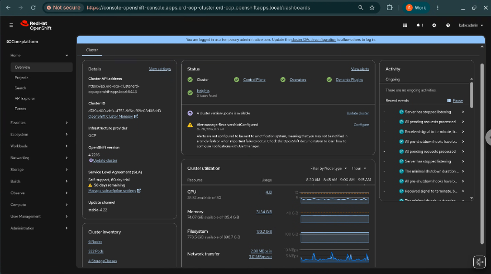

# Red Hat OpenShift Self-Managed on Google Cloud (Private Cluster Demo)

This repository provides a clean, automated, step-by-step framework for deploying a **Private Red Hat OpenShift Container Platform (OCP 4.22.16) Self-Managed Cluster** on **Google Cloud** using Installer-Provisioned Infrastructure (IPI) from a dedicated Linux Bastion VM.

---

## Purpose & Business Value

The purpose of this demo is to showcase an enterprise-ready **Red Hat OpenShift on Google Cloud** reference architecture that delivers measurable business value across security, reliability, cost efficiency, cloud-native integration, and continuous compliance:

| Business Pillar | Architectural Capability | Business Value & Impact |
| :--- | :--- | :--- |
| **Enterprise Security**<br>*(Private Cluster)* | **100% Private Cluster & Bastion** (`publish: Internal`) with no external public IPs, outbound internet via **Cloud NAT**, and zero-trust administrative access via **Cloud IAP**. | Eliminates public attack surface on control plane, worker nodes, and ingress endpoints to meet strict enterprise network security mandates. |
| **High Availability & Reliability**<br>*(Multi-Zone Topology)* | **Multi-Zone Distribution** of Control Plane (`master-0/1/2`) and Worker `MachineSet`s (`worker-a/b/c`) across 3 availability zones (`-a`, `-b`, `-c`). | Protects mission-critical workloads against single-zone outages and ensures continuous control plane quorum and application uptime. |
| **Cost Optimization & Lower TCO**<br>*(Custom Sizing & Hyperdisk)* | **Right-Sized Custom Compute (`n4-custom-6-20480`)** paired with **Google Cloud Hyperdisk Balanced** (`hyperdisk-balanced`) and automated idle VM stop/start (`08-stop-start-vms.sh`). | Avoids over-provisioning CPU/RAM for OpenShift worker nodes, decouples storage performance from VM size, and significantly lowers Total Cost of Ownership (TCO). |
| **Cloud-Native Managed Services**<br>*(Filestore & Secret Manager)* | First-class CSI integration with **Regional Enterprise Cloud Filestore** (`ReadWriteMany` shared NFS over Private Service Access) and **Google Cloud Secret Manager** (`tmpfs` in-memory secret mounts). | Accelerates application modernization by combining stateless and stateful OpenShift workloads with managed Google Cloud storage and centralized secret lifecycle management. |
| **Compliance & Security Governance**<br>*(Workload Manager — Preview)* | Automated telemetry collection via the **Cluster Services for OpenShift Telemetry Operator** into **Google Cloud Workload Manager**. | Continuously evaluates OpenShift clusters against Google Cloud and Red Hat best practices to detect configuration drift, strengthen security posture, and simplify compliance audits. |

---

## Key Features

- **Consistent Resource Naming**: A single naming prefix (`PREFIX`) names every GCP and OpenShift resource (VPC, 3 subnets, Cloud Router, Cloud NAT, Firewall rules, Service Account, SSH key, Bastion VM, Cluster, and Private Domain).
- **Automated `/20` Subnet Carving**: Input any `/20` VPC IP range (e.g., `10.90.32.0/20`) and the setup script automatically calculates non-overlapping `/23` (Control Plane), `/23` (Worker), and `/24` (Bastion) subnets.
- **Organization Policy Automation**: Checks and configures `iam.disableServiceAccountKeyCreation`, `iam.disableServiceAccountCreation`, and `compute.trustedImageProjects` (Domain Restricted Sharing `iam.allowedPolicyMemberDomains` does not need to be relaxed because Self-Managed OCP only uses service accounts within your own GCP project).
- **Private Cluster + Cloud NAT**: All cluster nodes and the Bastion VM run without external IP addresses (`publish: Internal`), using **Cloud NAT** for outbound internet access and **Cloud IAP** for secure SSH and HTTPS Web Console tunneling.
- **Multi-Zone High-Availability Architecture**: The OpenShift installer automatically distributes the 3 Control Plane nodes (`master-0`, `master-1`, `master-2`) and 3 Worker `MachineSet`s (`worker-a`, `worker-b`, `worker-c`) across multiple availability zones (`-a`, `-b`, `-c`) within the selected Google Cloud region.
- **Custom Compute & Hyperdisk Sizing**:
  - **Control Plane**: 3x `e2-standard-4` with `100GB pd-ssd`
  - **Workers**: 3x `n4-custom-6-20480` (6 vCPU, 20 GB RAM) with `200GB hyperdisk-balanced`

---

## Repository Structure

```text
ocp-gcp-demo/
├── README.md                          # Project overview & quickstart
├── docs/
│   ├── architecture.md                # Detailed architecture, network layout & sizing
│   ├── step-by-step-guide.md          # Complete end-to-end deployment & testing guide
│   └── images/                        # Screenshots of OpenShift Console, Cymbal Workloads & Workload Manager
├── scripts/
│   ├── 00-prereq-config.sh            # Interactive prompt for Project, Region, Prefix, /20 CIDR, Pull Secret
│   ├── 01-policy-check.sh             # Configures GCP Org Policies & enables required APIs
│   ├── 02-vpc-setup.sh                # Deploys VPC, 3 Subnets, Cloud Router, Cloud NAT & Firewalls
│   ├── 03-iam-and-keys.sh             # Creates SSH keypair, OCP Service Account, IAM bindings & JSON key
│   ├── 04-bastion-setup.sh            # Renders install-config.yaml, deploys Bastion VM & copies files
│   ├── 05-bastion-install-ocp.sh      # Run manually on Bastion VM to install OpenShift cluster
│   ├── 06-access-and-test.sh          # Connection tests, /etc/hosts setup & Console HTTPS tunnel
│   ├── 07-cleanup.sh                  # Full teardown of OpenShift cluster, Bastion, VPC, NAT, Subnets & SA
│   └── 08-stop-start-vms.sh           # Gracefully stop, start, or check status of Cluster & Bastion VMs
├── templates/
│   └── install-config.yaml.tpl        # OpenShift IPI template with custom VM sizes & Hyperdisk
├── workloads/                         # Phase 2 (Optional): Google Cloud Cymbal Demo Workloads
│   ├── README.md                      # Phase 2 overview & quickstart
│   ├── sync-to-bastion.sh             # Syncs workloads/ to ~/ocp-setup/workloads/ on the Bastion VM
│   ├── docs/
│   │   ├── architecture-phase2.md     # Architectural diagrams for Filestore, Hyperdisk & Secret Manager CSI
│   │   ├── option1-filestore-stateless-guide.md
│   │   └── option2-hyperdisk-secrets-stateful-guide.md
│   ├── option1-filestore-stateless/   # Option 1: Stateless Cymbal Storefront + Regional Private Filestore CSI
│   └── option2-hyperdisk-stateful/    # Option 2: Stateful Cymbal Order Ledger + Hyperdisk + Secret Manager CSI
└── workload-manager/           # Phase 3 (Optional): Workload Manager & OpenShift Telemetry Operator (Preview)
    ├── README.md                      # Phase 3 overview & quickstart
    ├── sync-to-bastion.sh             # Syncs workload-manager/ to ~/ocp-setup/ on the Bastion VM
    ├── docs/
    │   └── workload-manager-telemetry-guide.md
    ├── manifests/                     # OLM Subscription, TelemetryConfig CR & production evaluation tags
    └── scripts/                       # Automated GCP IAM, operator installation, on-demand trigger & cleanup
```

---

## Quickstart Workflow

> [!IMPORTANT]
> **Where Each Script Runs**:
> - **Scripts `00` through `04`, `06`, and `07`** run on your **Local Workstation**.
> - **Script `05` (`~/ocp-setup/05-bastion-install-ocp.sh`)** runs **ONLY inside the Bastion VM** after you SSH into it.
> - **Script `06` (`./scripts/06-access-and-test.sh`)** runs on your **Local Workstation** (not inside the Bastion VM) to test the cluster remotely and open the local port-forwarding tunnel to your browser.

| Step | Script / Command | Where to Run | Description |
| :--- | :--- | :--- | :--- |
| **0** | `./scripts/00-prereq-config.sh` | **Local Workstation** | Prompts for GCP Project, Region, Prefix, `/20` CIDR, and Red Hat Pull Secret file ([download here](https://console.redhat.com/openshift/install/pull-secret)); generates `config.env`. *(Note: If you or your organization don't have a Red Hat subscription, you can open a Red Hat account for free and use the **60-day self-support trial license** for the deployment.)* |
| **1** | `./scripts/01-policy-check.sh` | **Local Workstation** | Enables GCP APIs and configures Org Policies (SA Creation, SA Keys, and Trusted Images). |
| **2** | `./scripts/02-vpc-setup.sh` | **Local Workstation** | Creates VPC, 3 Subnets (`control-plane`, `worker`, `bastion`), Cloud Router + Cloud NAT, and IAP/Internal firewall rules. |
| **3** | `./scripts/03-iam-and-keys.sh` | **Local Workstation** | Generates Ed25519 SSH key pair, creates OCP Service Account, binds IAM roles, and exports SA JSON key. |
| **4** | `./scripts/04-bastion-setup.sh` | **Local Workstation** | Renders `install-config.yaml`, provisions the private Bastion Linux VM, and copies all required files to `~/ocp-setup/`. |
| **5** | `~/ocp-setup/05-bastion-install-ocp.sh` | **Bastion VM Only** | SSH into the Bastion VM using the command printed by Step 4 and manually start the OpenShift cluster installation. |
| **6** | `./scripts/06-access-and-test.sh test` | **Local Workstation** | Connects from your Local Workstation through the Bastion to test private DNS, API health (`:6443`), Console route (`:443`), and node readiness. |
| **7** | `./scripts/06-access-and-test.sh hosts`<br>`./scripts/06-access-and-test.sh tunnel` | **Local Workstation** | Configures local `/etc/hosts` and opens the IAP HTTPS/HTTP tunnel (`127.0.0.2:443` & `:80`) on your Local Workstation for Web Console and app access. |
| **8** | `./scripts/08-stop-start-vms.sh [status\|stop\|start]` | **Local Workstation** | Gracefully stops or restarts all Cluster VMs (Workers $\leftrightarrow$ Masters) and the Bastion VM when idle to save compute costs, and auto-approves node CSRs on start. |
| **9** | `./scripts/07-cleanup.sh` | **Local Workstation** | Destroys the OpenShift cluster, Bastion VM, Firewall rules, Cloud NAT/Router, Subnets, VPC, and Service Account. |

### Phase 1 Screenshot: Red Hat OpenShift 4.22.16 Web Console (via Cloud IAP Tunnel)



---

## Customizing VM Sizes & Disk Types (`install-config.yaml`)

You can customize the Control Plane (`controlPlane`) and Worker (`compute`) machine types, replica counts, and OS disk types in two ways:
1. **Before running `./scripts/04-bastion-setup.sh`**: Edit [`templates/install-config.yaml.tpl`](templates/install-config.yaml.tpl) on your local machine.
2. **On the Bastion VM before running `05-bastion-install-ocp.sh`**: Edit `~/ocp-setup/install-config.yaml` directly on the Bastion VM.

```yaml
compute:
- architecture: amd64
  hyperthreading: Enabled
  name: worker
  replicas: 3                        # Number of worker nodes
  platform:
    gcp:
      type: n4-custom-6-20480        # e.g., n4-standard-4, n4-custom-6-20480, n2-standard-4, e2-standard-4
      osDisk:
        diskType: hyperdisk-balanced # Use hyperdisk-balanced for N4/C4; use pd-ssd or pd-balanced for E2/N2
        diskSizeGB: 200
controlPlane:
  architecture: amd64
  hyperthreading: Enabled
  name: master
  replicas: 3                        # Must be 3 for HA control plane
  platform:
    gcp:
      type: e2-standard-4            # e.g., e2-standard-4, e2-standard-8, n2-standard-4, n4-standard-4
      osDisk:
        diskType: pd-ssd             # Use pd-ssd for E2/N2; use hyperdisk-balanced for N4
        diskSizeGB: 100
```

> [!IMPORTANT]
> **GCP Machine Series, Disk Type & OCP Version Notes**:
> - **N4 / C4 machine series** (`n4-standard-*`, `n4-custom-*`) **only** support Hyperdisk (`hyperdisk-balanced`). They do not support `pd-ssd` or `pd-standard`.
> - **E2 / N2 / N2D machine series** (`e2-standard-*`, `n2-standard-*`) use Persistent Disk (`pd-ssd` or `pd-balanced`).
> - Custom machine types follow the format `<series>-custom-<vCPU>-<RAM_in_MB>` (for example, `n4-custom-6-20480` = 6 vCPUs and 20,480 MB / 20 GB RAM).
> - **Changing the OCP Version (`4.22.16`)**: If you change the OpenShift version from `4.22.16` to another version, check the [Red Hat Google Cloud Marketplace image documentation](https://docs.redhat.com/en/documentation/openshift_container_platform/4.22/html/installing_on_google_cloud/installing-gcp-customizations#installation-gcp-marketplace_installing-gcp-customizations) for the corresponding Marketplace image ID and update `osImage.name` accordingly.

---

## Known & Solved Issues / Platform Notes

- **Red Hat Account & Free 60-Day Trial License**:
  - If you or your organization don't have an active Red Hat OpenShift subscription, you can open a Red Hat account for free at [console.redhat.com](https://console.redhat.com/openshift/install/pull-secret) and use the **60-day trial license** (`Self-support, 60 day trial`) to download the pull secret and deploy the cluster.

- **Solved Issue: `MachineWithoutValidNode` Warning (Worker Stuck in `Provisioned` Phase with Marketplace Image & UEFI Secure Boot)**:
  - **Symptom**: One or more worker `Machine` objects remain in `Provisioned` phase (`machine <worker> does not have valid node reference`) even though the VM is `RUNNING` in Google Cloud, and the VM serial console shows `error: ../../grub-core/kern/efi/sb.c:182:bad shim signature` when booting `Red Hat Enterprise Linux CoreOS 9.8`.
  - **Why Only Some Nodes Were Affected**: When using the Google Cloud Marketplace image (`redhat-coreos-ocp-413-x86-64-202305021736`), every node initially boots into RHCOS 4.13 (2023 UEFI `shimx64.efi`), downloads the OCP 4.22 (RHCOS 9.8) image, runs `bootupd` to update `/boot/efi/EFI/redhat/shimx64.efi`, and reboots. If the pivot reboot triggers before the updated 4.22 `shimx64.efi` flushes to `/boot/efi` on a node, the 2023 shim rejects the 2026 RHCOS 9.8 kernel signature when GCP Shielded VM Secure Boot (`secureBoot: Enabled`) is active.
  - **Fix (Automated in `04-bastion-setup.sh`)**: `04-bastion-setup.sh` now automatically sets `secureBoot: Disabled` in `install-config.yaml` whenever `USE_MARKETPLACE_IMAGE="true"`. To recover an already-stuck VM without recreating it:
    ```bash
    gcloud compute instances stop <VM_NAME> --zone=<ZONE> --project=<PROJECT_ID>
    gcloud compute instances update <VM_NAME> --zone=<ZONE> --project=<PROJECT_ID> --no-shielded-secure-boot
    gcloud compute instances start <VM_NAME> --zone=<ZONE> --project=<PROJECT_ID>
    # Then approve the node's pending CSRs on the Bastion VM:
    oc get csr -o name | xargs oc adm certificate approve
    ```

- **Windows WSL (WSL 2) Compatibility & Setup**:
  All scripts (`00` through `07` and Phase 2 scripts) are fully compatible with **Windows Subsystem for Linux (WSL 2)**. Follow these steps when running on WSL:
  1. **Clone inside the Linux filesystem (`~/...`)**: Always clone and run this repository inside your native WSL home directory (e.g., `cd ~ && git clone https://github.com/erdemgu/ocp-gcp-demo.git`), **not** under `/mnt/c/...`. Mounted Windows drives (`/mnt/c/`) ignore `chmod 600` on SSH keys by default, which causes SSH to reject private keys.
  2. **Automatic `127.0.0.1` Tunnel Binding on WSL**: By default, Windows WSL 2 NAT mode forwards `127.0.0.1` (not `127.0.0.2`) from the Windows host browser into the WSL 2 VM. `00-prereq-config.sh` automatically detects WSL and sets `CONSOLE_LOCAL_IP="127.0.0.1"` in `config.env`.
  3. **Update the Windows `hosts` File for Windows Browsers**: Because Chrome/Edge on Windows reads `C:\Windows\System32\drivers\etc\hosts` (rather than WSL's `/etc/hosts`), running `./scripts/06-access-and-test.sh hosts` inside WSL will print a ready-to-copy **Administrator PowerShell** command to add the OpenShift Console and Cymbal app hostnames to `C:\Windows\System32\drivers\etc\hosts`.

- **Missing Worker Nodes in Some Zones (`n4-custom-*` Zone Availability)**:
  - Because this is a multi-zone architecture, OpenShift distributes worker `MachineSet`s across zones (`-a`, `-b`, `-c`). If `n4-custom-*` (such as `n4-custom-6-20480`) is not available in all zones of your selected region (for example, available in `a` and `b` but not `c`), you may see only `worker-a` and `worker-b` nodes running or fewer worker nodes than requested.
  - **Workaround**: Check `oc get machineset -n openshift-machine-api` on the Bastion VM and either scale up an available zone's `MachineSet` (e.g., `oc scale machineset <worker-a-machineset> -n openshift-machine-api --replicas=2`) or select a machine series available across all zones in that region.

---

## Phase 2 (Optional): Google Cloud Cymbal Demo Workloads

Phase 2 is optional and provides **two independent workload options** built around **Google Cloud Cymbal** sample applications. You can deploy either option individually or both side-by-side:

| Option | Workload & Pattern | Google Cloud & OpenShift Integrations | Guide |
| :--- | :--- | :--- | :--- |
| **Option 1** | **Cymbal Retail Storefront**<br>*(Stateless 3-Replica Web App)* | • **GCP Filestore CSI Driver Operator** (`filestore.csi.storage.gke.io`)<br>• **Regional Private Cloud Filestore** (`enterprise` tier, `ReadWriteMany` NFS)<br>• **Private Service Access (PSA)** `/20` peering to cluster VPC | [Option 1 Guide](workloads/docs/option1-filestore-stateless-guide.md) |
| **Option 2** | **Cymbal Order & Inventory Ledger**<br>*(Stateful PostgreSQL 16 + Web UI)* | • **Google Cloud Hyperdisk Balanced** (`pd.csi.storage.gke.io`, `ReadWriteOnce`)<br>• **Secrets Store CSI Driver Operator** (`secrets-store.csi.k8s.io`)<br>• **Google Cloud Secret Manager** (`csi-secrets-store-provider-gcp`) | [Option 2 Guide](workloads/docs/option2-hyperdisk-secrets-stateful-guide.md) |

See [**`workloads/README.md`**](workloads/README.md) and [**`workloads/docs/architecture-phase2.md`**](workloads/docs/architecture-phase2.md) for full architecture diagrams and deployment instructions.

### Phase 2 Screenshots

#### Option 1: Stateless Cymbal Retail Storefront + Regional Cloud Filestore (`ReadWriteMany`)


#### Option 2: Stateful Cymbal Order & Inventory Ledger + Hyperdisk Balanced + Secret Manager CSI


---

## Phase 3 (Optional): Google Cloud Workload Manager & OpenShift Telemetry Operator (Preview)

> [!IMPORTANT]
> **Preview Feature Notice**: Google Cloud Workload Manager evaluations for Red Hat OpenShift and the **Cluster Services for OpenShift Telemetry Operator** (`google-cloud-cluster-services-for-openshift-telemetry`) are currently in **Preview** (Pre-GA) and subject to the "Pre-GA Offerings Terms" of the Google Cloud Terms of Service. See the official [Set up Cluster Services for OpenShift Telemetry Operator](https://docs.cloud.google.com/workload-manager/docs/evaluate/set-up-operator-for-openshift) documentation for details.

Phase 3 is optional and installs the **Cluster Services for OpenShift Telemetry Operator** (`google-cloud-cluster-services-for-openshift-telemetry`, Preview) to collect cluster configuration, node, storage, and security metrics and evaluate your OpenShift cluster against Google Cloud and Red Hat best practices in **Google Cloud Workload Manager**:

| Component | Description | Guide |
| :--- | :--- | :--- |
| **Cluster Services for OpenShift Telemetry Operator** | • Installs `google-cloud-cluster-services-for-openshift-telemetry` (`certified-operators`, `stable` channel)<br>• Configures `TelemetryConfig` (`telemetryconfig`) & `workloadmanager` production evaluation tags<br>• Triggers immediate on-demand telemetry collection & verifies Cloud Logging (`google-cloud-workload-agent`) | [Phase 3 Guide](workload-manager/docs/workload-manager-telemetry-guide.md) |

See [**`workload-manager/README.md`**](workload-manager/README.md) for quickstart commands.

### Phase 3 Screenshot: Google Cloud Workload Manager OpenShift Evaluation Report


---

## Documentation Links

- [**Phase 1 Architecture Guide (`docs/architecture.md`)**](docs/architecture.md)
- [**Phase 1 Step-by-Step Deployment Guide (`docs/step-by-step-guide.md`)**](docs/step-by-step-guide.md)
- [**Phase 2 Workloads Overview (`workloads/README.md`)**](workloads/README.md)
- [**Phase 2 Architecture Guide (`workloads/docs/architecture-phase2.md`)**](workloads/docs/architecture-phase2.md)
- [**Phase 2 Option 1: Stateless Cymbal + Regional Filestore Guide (`workloads/docs/option1-filestore-stateless-guide.md`)**](workloads/docs/option1-filestore-stateless-guide.md)
- [**Phase 2 Option 2: Stateful Cymbal + Hyperdisk + Secret Manager Guide (`workloads/docs/option2-hyperdisk-secrets-stateful-guide.md`)**](workloads/docs/option2-hyperdisk-secrets-stateful-guide.md)
- [**Phase 3 Overview (`workload-manager/README.md`)**](workload-manager/README.md)
- [**Phase 3 Step-by-Step Guide: Workload Manager & Telemetry Operator (`workload-manager/docs/workload-manager-telemetry-guide.md`)**](workload-manager/docs/workload-manager-telemetry-guide.md)

## Official References & Further Information

- [Red Hat OpenShift Container Platform 4.22: Installing on Google Cloud](https://docs.redhat.com/en/documentation/openshift_container_platform/4.22/html/installing_on_google_cloud/index)
- [Red Hat OpenShift 4.22: Google Cloud Marketplace Image Customizations](https://docs.redhat.com/en/documentation/openshift_container_platform/4.22/html/installing_on_google_cloud/installing-gcp-customizations#installation-gcp-marketplace_installing-gcp-customizations)
- [Red Hat OpenShift Container Platform Life Cycle Policy](https://access.redhat.com/product-life-cycles?product=Red%20Hat%20OpenShift%20Container%20Platform)
- [Google Cloud: Red Hat OpenShift on Google Cloud Overview](https://docs.cloud.google.com/openshift-cluster/openshift-overview)
- [Google Cloud Workload Manager: Set up Cluster Services for OpenShift Telemetry Operator](https://docs.cloud.google.com/workload-manager/docs/evaluate/set-up-operator-for-openshift)
- [Google Cloud & Red Hat Solutions](https://cloud.google.com/solutions/redhat)
- [Google Cloud Blog: Red Hat OpenShift on Google Cloud Migration and Scaling Updates](https://cloud.google.com/blog/topics/partners/red-hat-openshift-on-google-cloud-migration-and-scaling-updates)
- [Red Hat Hybrid Cloud Console: Download OpenShift Pull Secret](https://console.redhat.com/openshift/install/pull-secret)
