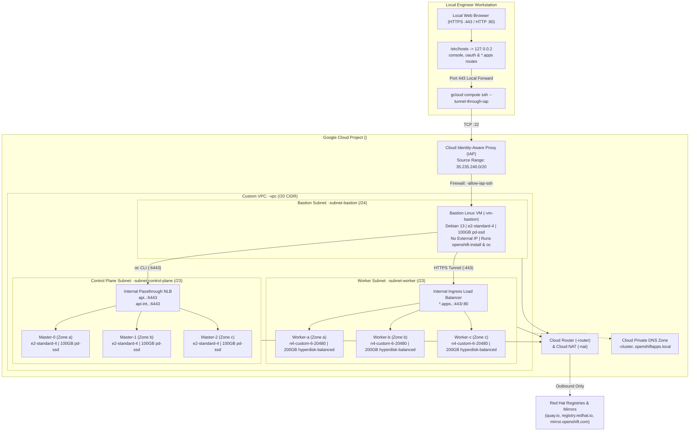

# Architecture: Red Hat OpenShift Self-Managed Private Cluster on Google Cloud

This document describes the architecture, network topology, compute/storage sizing, security model, and connectivity design for the Red Hat OpenShift Container Platform (OCP) self-managed private cluster on Google Cloud.

---

## 1. High-Level Architecture Diagram

---

## 2. Naming Convention

Every resource created in the Google Cloud project uses the user-supplied `PREFIX` variable to ensure isolation, clarity, and easy cleanup:

| Resource Type | Naming Pattern | Example (`PREFIX=ocp-demo`) |
| :--- | :--- | :--- |
| **VPC Network** | `${PREFIX}-vpc` | `ocp-demo-vpc` |
| **Control Plane Subnet** | `${PREFIX}-subnet-control-plane` | `ocp-demo-subnet-control-plane` |
| **Worker Subnet** | `${PREFIX}-subnet-worker` | `ocp-demo-subnet-worker` |
| **Bastion Subnet** | `${PREFIX}-subnet-bastion` | `ocp-demo-subnet-bastion` |
| **Cloud Router** | `${PREFIX}-router` | `ocp-demo-router` |
| **Cloud NAT** | `${PREFIX}-nat` | `ocp-demo-nat` |
| **IAP Firewall Rule** | `${PREFIX}-allow-iap-ssh` | `ocp-demo-allow-iap-ssh` |
| **Internal Firewall Rule** | `${PREFIX}-allow-internal` | `ocp-demo-allow-internal` |
| **Service Account** | `${PREFIX}-ocp-sa` | `ocp-demo-ocp-sa@<project-id>.iam.gserviceaccount.com` |
| **SA Key File** | `${PREFIX}-sa-key.json` | `ocp-demo-sa-key.json` |
| **SSH Key Pair** | `${PREFIX}-ssh` / `.pub` | `ocp-demo-ssh` / `ocp-demo-ssh.pub` |
| **Bastion VM** | `${PREFIX}-vm-bastion` | `ocp-demo-vm-bastion` |
| **OCP Cluster Name** | `${PREFIX}-cluster` | `ocp-demo-cluster` |
| **Private Base Domain** | `${PREFIX}.openshiftapps.local` | `ocp-demo.openshiftapps.local` |

---

## 3. Network & Subnet Design (`/20` Allocation)

The user provides a single `/20` CIDR block (4,096 IP addresses), from which `00-prereq-config.sh` automatically carves out three non-overlapping subnets:

| Subnet Purpose | Subnet Name | Size | Example (`10.90.32.0/20`) | Usable IPs | Private Google Access |
| :--- | :--- | :--- | :--- | :--- | :--- |
| **VPC Machine Network** | `${PREFIX}-vpc` | `/20` | `10.90.32.0/20` | 4,092 | N/A |
| **Control Plane Subnet** | `${PREFIX}-subnet-control-plane` | `/23` | `10.90.32.0/23` | 508 | Enabled |
| **Worker Subnet** | `${PREFIX}-subnet-worker` | `/23` | `10.90.34.0/23` | 508 | Enabled |
| **Bastion Subnet** | `${PREFIX}-subnet-bastion` | `/24` | `10.90.36.0/24` | 252 | Enabled |
| **Remaining Spare Space** | *(Reserved for future services)* | `/24` + `/22` + `/21` | `10.90.37.0` – `10.90.47.255` | ~2,800 | N/A |

### OpenShift Internal Overlay Networks
- **Cluster Network (Pod CIDR)**: `10.128.0.0/14` (`hostPrefix: 23`, allowing up to 510 pods per node)
- **Service Network (Service CIDR)**: `172.30.0.0/16`
- **CNI Plugin**: `OVNKubernetes`

### Outbound Internet Access via Cloud NAT
Because both the Bastion VM and the OpenShift cluster nodes are deployed as **strictly private instances** (`publish: Internal` and `--no-address`), **Cloud Router (`${PREFIX}-router`)** and **Cloud NAT (`${PREFIX}-nat`)** are deployed in the region with:
- `--nat-all-subnet-ip-ranges` (covers Bastion, Control Plane, and Worker subnets)
- `--auto-allocate-nat-external-ips`
- `--enable-dynamic-port-allocation` (`min-ports-per-vm=1024`, `max-ports-per-vm=65536`) to prevent SNAT port exhaustion during heavy container image pulls from `quay.io` and `registry.redhat.io`.

---

## 4. Compute & Storage Sizing (`install-config.yaml`)

The cluster preserves custom Google Cloud N4 machine types with Hyperdisk Balanced storage for workers and E2 machine types for control plane and bastion nodes:

| Role | Replicas | Machine Type | vCPU / Memory | Disk Type | Disk Size | Notes |
| :--- | :--- | :--- | :--- | :--- | :--- | :--- |
| **Bastion VM** | 1 | `e2-standard-4` | 4 vCPU / 16 GB | `pd-ssd` | 100 GB | Debian 13, Secure Boot enabled, IAP SSH only, hosts `openshift-install` & `oc` |
| **Control Plane** | 3 | `e2-standard-4` | 4 vCPU / 16 GB | `pd-ssd` | 100 GB | Multi-zone (`a`, `b`, `c`), RHCOS, Secure Boot enabled, hosts etcd & API server |
| **Worker (Compute)** | 3 | `n4-custom-6-20480` | 6 vCPU / 20 GB | `hyperdisk-balanced` | 200 GB | Multi-zone (`a`, `b`, `c`), RHCOS, Next-Gen N4 custom shape + Hyperdisk Balanced |

> [!NOTE]
> **Multi-Zone Architecture**: This deployment uses a regional **multi-zone architecture**. Because Google Cloud VPC subnets are regional, the OpenShift IPI installer automatically spreads the 3 Control Plane nodes (`master-0`, `master-1`, `master-2`) and 3 Worker `MachineSet`s (`worker-a`, `worker-b`, `worker-c`) across three availability zones (`${REGION}-a`, `${REGION}-b`, and `${REGION}-c`) inside the regional subnets (`${PREFIX}-subnet-control-plane` and `${PREFIX}-subnet-worker`) for high availability. Ensure your selected machine types (such as `n4-custom-6-20480`) are available in all zones of the target region.

### Google Cloud Marketplace Offering (`osImage` for Worker & Master)
Optionally, both worker (`compute.platform.gcp.osImage`) and control plane (`controlPlane.platform.gcp.osImage`) machines can be deployed using a Google Cloud Marketplace offering image (`project: redhat-marketplace-public`). See [Installing on Google Cloud: Marketplace Customizations](https://docs.redhat.com/en/documentation/openshift_container_platform/4.22/html/installing_on_google_cloud/installing-gcp-customizations#installation-gcp-marketplace_installing-gcp-customizations):
- **OpenShift Container Platform**: `redhat-coreos-ocp-413-x86-64-202305021736`
- **OpenShift Platform Plus**: `redhat-coreos-opp-413-x86-64-202305021736`
- **OpenShift Kubernetes Engine**: `redhat-coreos-oke-413-x86-64-202305021736`

> [!NOTE]
> If you change the OpenShift version from `4.22.16` to another version, check the [Red Hat Google Cloud Marketplace customization article](https://docs.redhat.com/en/documentation/openshift_container_platform/4.22/html/installing_on_google_cloud/installing-gcp-customizations#installation-gcp-marketplace_installing-gcp-customizations) for that release's Marketplace image ID and update it accordingly.

---

## 5. Organization Policies & IAM Security

### Organization Policies (`01-policy-check.sh`)
In enterprise Google Cloud environments, two categories of Organization Policies commonly block OpenShift self-managed installations. `01-policy-check.sh` inspects and configures project-level overrides for:
1. **Service Account & Key Creation (`constraints/iam.disableServiceAccountKeyCreation`, `constraints/iam.managed.disableServiceAccountKeyCreation`, `constraints/iam.disableServiceAccountCreation`, `constraints/iam.managed.disableServiceAccountCreation`)**: Set to `enforce: false` so both legacy and managed constraints allow creating the OpenShift installer service account, its key (`${PREFIX}-sa-key.json`), and in-cluster operator service accounts/keys.
2. **`constraints/compute.trustedImageProjects`**: Checks and allows `projects/debian-cloud` (Bastion VM), `projects/rhel-cloud`, `projects/rhcos-cloud` (Red Hat Enterprise Linux CoreOS), `projects/redhat-marketplace-public`, and `projects/mpi-redhat-marketplace-public` (Google Cloud Marketplace partner images).

> [!NOTE]
> **Domain Restricted Sharing (`constraints/iam.allowedPolicyMemberDomains`) Is Not Required**: Unlike Red Hat OpenShift Dedicated (OSD), **Self-Managed OCP** does not grant GCP IAM roles to `@redhat.com` or any external domain accounts. Every service account created by the setup scripts and `openshift-install` resides inside your own GCP project (`@${PROJECT_ID}.iam.gserviceaccount.com`), so `iam.allowedPolicyMemberDomains` can remain enforced for your organization.

### Private DNS & Web Console Access Flow
1. During `openshift-install create cluster`, the installer creates a **Cloud DNS Private Managed Zone** for `${CLUSTER_NAME}.${BASE_DOMAIN}` bound to `${PREFIX}-vpc`.
2. Internal Load Balancers are provisioned inside the VPC for:
   - `api.${CLUSTER_NAME}.${BASE_DOMAIN}` (Port `6443`)
   - `*.apps.${CLUSTER_NAME}.${BASE_DOMAIN}` (Ports `443` and `80`)
3. Because the DNS zone and Load Balancers are private to `${PREFIX}-vpc`, external workstations access the Web Console and published applications using a single dedicated local loopback IP **`127.0.0.2`** (keeping `127.0.0.1` free for other local apps/tunnels):
   - Every OpenShift `Route` under `*.apps.${CLUSTER_NAME}.${BASE_DOMAIN}` (including `console-openshift-console`, `oauth-openshift`, and Phase 2 application routes) is served by the same OpenShift Ingress Router VIP using TLS SNI (`:443`) and HTTP `Host` headers (`:80`).
   - Mapping `console-openshift-console.apps.${CLUSTER_NAME}.${BASE_DOMAIN}`, `oauth-openshift.apps.${CLUSTER_NAME}.${BASE_DOMAIN}`, and any application route hostnames to `127.0.0.2` in `/etc/hosts` allows a **single IAP SSH tunnel** (`-L 127.0.0.2:443:...:443 -L 127.0.0.2:80:...:80`) through `${PREFIX}-vm-bastion` to serve both the Web Console and all published apps.

---

## 6. Official References & More Information

- [Red Hat OpenShift Container Platform 4.22: Installing on Google Cloud](https://docs.redhat.com/en/documentation/openshift_container_platform/4.22/html/installing_on_google_cloud/index)
- [Red Hat OpenShift Container Platform Life Cycle Policy](https://access.redhat.com/product-life-cycles?product=Red%20Hat%20OpenShift%20Container%20Platform)
- [Google Cloud: Red Hat OpenShift on Google Cloud Overview](https://docs.cloud.google.com/openshift-cluster/openshift-overview)
- [Google Cloud & Red Hat Solutions](https://cloud.google.com/solutions/redhat)
- [Google Cloud Blog: Red Hat OpenShift on Google Cloud Migration and Scaling Updates](https://cloud.google.com/blog/topics/partners/red-hat-openshift-on-google-cloud-migration-and-scaling-updates)
