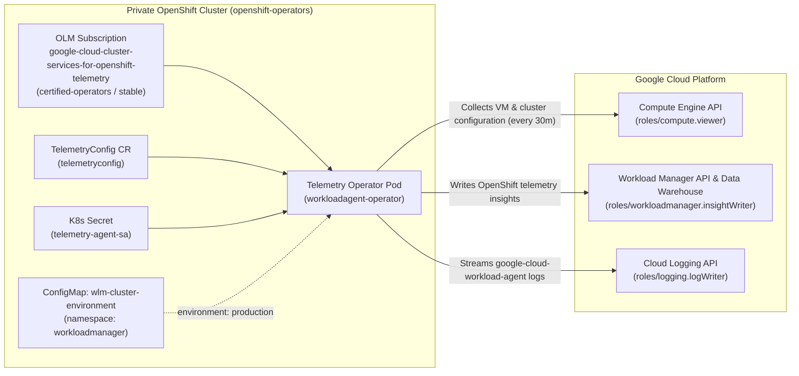
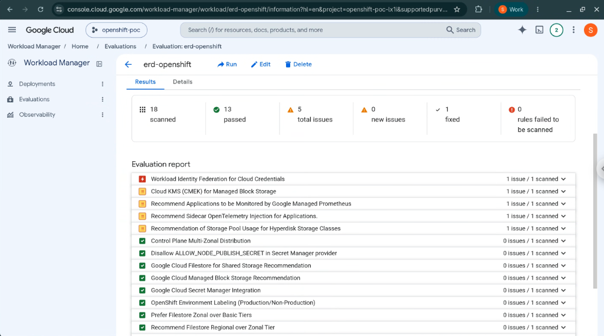

# Phase 3 (Optional): Google Cloud Workload Manager & Cluster Services for OpenShift Telemetry Operator (Preview)

Phase 3 is **optional** and installs the **Cluster Services for OpenShift Telemetry Operator** (`google-cloud-cluster-services-for-openshift-telemetry`, Preview) on your private Red Hat OpenShift Container Platform (OCP 4.22) cluster.

Once installed and configured via a `TelemetryConfig` custom resource, the operator continuously collects OpenShift cluster health, node configuration, storage, and security telemetry (every 30 minutes or on-demand) and sends insights to **Google Cloud Workload Manager** so you can evaluate your cluster against Google Cloud and Red Hat best practices.

> [!IMPORTANT]
> **Preview Feature Notice**: Google Cloud Workload Manager support for Red Hat OpenShift and the **Cluster Services for OpenShift Telemetry Operator** (`google-cloud-cluster-services-for-openshift-telemetry`) are currently in **Preview** (Pre-GA). Features, custom resource specifications (`TelemetryConfig`), and evaluation rules may change before General Availability.
> - **Official Google Cloud Documentation**: [Set up Cluster Services for OpenShift Telemetry Operator](https://docs.cloud.google.com/workload-manager/docs/evaluate/set-up-operator-for-openshift)

---

## Architecture Overview



---

## Directory Structure

```text
workload-manager/
├── README.md                                   # Phase 3 overview, architecture & quickstart
├── sync-to-bastion.sh                          # Copies workload-manager/ to ~/ocp-setup/ on Bastion VM
├── docs/
│   └── workload-manager-telemetry-guide.md     # Complete step-by-step guide, WIF option & WLM Console evaluation
├── manifests/
│   ├── 01-telemetry-subscription.yaml          # OLM Subscription (certified-operators / stable)
│   ├── 02-telemetry-config.yaml                # TelemetryConfig CR (telemetryconfig in openshift-operators)
│   └── 03-wlm-production-env.yaml              # Namespace workloadmanager + ConfigMap wlm-cluster-environment
└── scripts/
    ├── 01-prereq-wlm-iam.sh                    # Enables Workload Manager API, creates SA, binds 3 IAM roles & K8s secret
    ├── 02-deploy-telemetry-operator.sh         # Installs Operator Subscription, waits for CSV Succeeded, applies TelemetryConfig
    ├── 03-trigger-and-verify.sh                # Verifies operator pod, triggers immediate collection & checks Cloud Logging
    └── 04-cleanup-phase3.sh                    # Removes TelemetryConfig, Operator Subscription/CSV, K8s Secret & GCP SA
```

---

## Quickstart

### 1. Sync Phase 3 Files to the Bastion VM (Run on Local Workstation)
*(Note: `04-bastion-setup.sh` also copies `workload-manager/` automatically during initial setup. Use `sync-to-bastion.sh` anytime to push updates).*
```bash
./workload-manager/sync-to-bastion.sh
```

### 2. SSH into the Bastion VM
```bash
./scripts/06-access-and-test.sh ssh
```

### 3. Deploy & Verify the Telemetry Operator (Run Inside Bastion VM)
```bash
cd ~/ocp-setup/workload-manager
./scripts/01-prereq-wlm-iam.sh
./scripts/02-deploy-telemetry-operator.sh
./scripts/03-trigger-and-verify.sh
```

### 4. Cleanup Phase 3 (Optional, Run Inside Bastion VM)
```bash
cd ~/ocp-setup/workload-manager
./scripts/04-cleanup-phase3.sh
```

---

## Documentation

- [**Phase 3 Complete Step-by-Step Guide (`docs/workload-manager-telemetry-guide.md`)**](docs/workload-manager-telemetry-guide.md)

---

## Screenshot: Google Cloud Workload Manager OpenShift Evaluation


