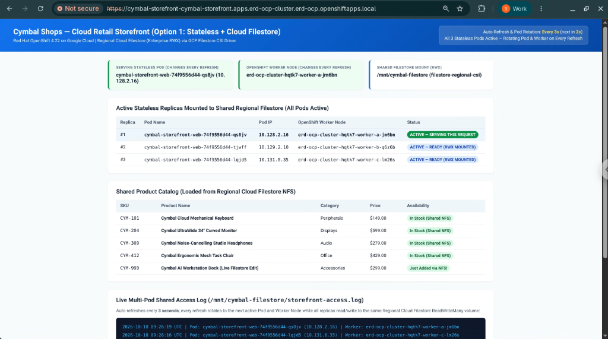
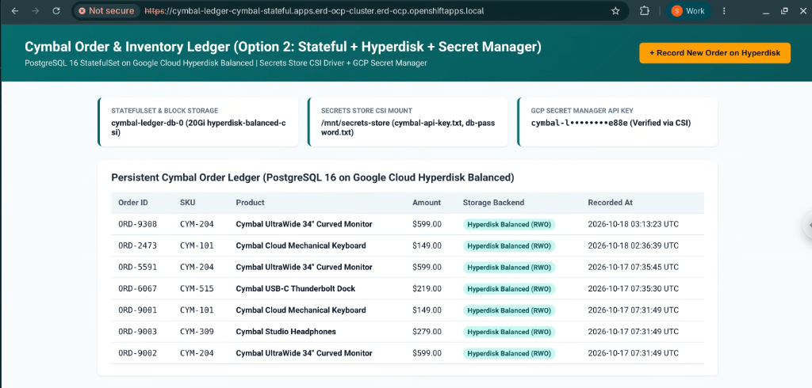

# Phase 2 (Optional): Google Cloud Cymbal Demo Workloads

Phase 2 is **optional** and provides **two independent workload options** showcasing Google Cloud storage and security integrations on your private Red Hat OpenShift Container Platform (OCP 4.22) cluster using **Google Cloud Cymbal** sample applications.

You can deploy **Option 1**, **Option 2**, or **both** in any order after your base OpenShift cluster is running.

---

## Workload Options Overview

| Option | Cymbal Application | Workload Pattern | Storage Integration | Security / CSI Operators |
| :--- | :--- | :--- | :--- | :--- |
| **Option 1** | **Cymbal Retail Storefront** (`cymbal-storefront`) | **Stateless** multi-replica web frontend (`replicas: 3`) across zones | **Google Cloud Filestore Regional (Enterprise)** (`ReadWriteMany` NFS via Private Service Access) | **GCP Filestore CSI Driver Operator** (`filestore.csi.storage.gke.io`) |
| **Option 2** | **Cymbal Order & Inventory Ledger** (`cymbal-stateful`) | **Stateful** PostgreSQL database (`StatefulSet`) + Cymbal Ledger UI | **Google Cloud Hyperdisk Balanced** (`ReadWriteOnce` block storage via `pd.csi.storage.gke.io`) | **Secrets Store CSI Driver Operator** (`secrets-store.csi.k8s.io`) + **Google Cloud Secret Manager** |

---

## Directory Structure

```text
workloads/
├── README.md                                           # Phase 2 overview & quickstart
├── sync-to-bastion.sh                                  # Copies workloads/ directory to ~/ocp-setup/workloads on Bastion VM
├── docs/
│   ├── architecture-phase2.md                          # Architecture diagrams & technical design for Options 1 & 2
│   ├── option1-filestore-stateless-guide.md            # Step-by-step guide for Option 1 (Filestore + Stateless Cymbal)
│   └── option2-hyperdisk-secrets-stateful-guide.md     # Step-by-step guide for Option 2 (Hyperdisk + Secret Manager + Stateful Cymbal)
├── option1-filestore-stateless/
│   ├── scripts/
│   │   ├── 01-prereq-filestore-psa.sh                  # Enables Filestore/PSA APIs, IAM roles & VPC Peering
│   │   ├── 02-deploy-filestore-csi.sh                  # Installs GCP Filestore CSI Driver Operator & Regional StorageClass
│   │   ├── 03-deploy-cymbal-stateless.sh               # Deploys Cymbal Storefront (3 replicas + RWX Filestore PVC + Route)
│   │   └── 04-cleanup-option1.sh                       # Removes Option 1 workload, PVC, Filestore instance & CSI resources
│   └── manifests/
│       ├── 01-filestore-csi-operator.yaml              # Subscription & ClusterCSIDriver (filestore.csi.storage.gke.io)
│       ├── 02-filestore-storageclass.yaml.tpl          # Regional Private Filestore StorageClass template
│       ├── 03-cymbal-filestore-pvc.yaml                # Namespace & 1Ti ReadWriteMany PVC
│       └── 04-cymbal-stateless-app.yaml                # Cymbal Storefront 3-replica Deployment, Service & TLS Route
└── option2-hyperdisk-stateful/
    ├── scripts/
    │   ├── 01-prereq-secretmanager.sh                  # Enables Secret Manager API, IAM roles & creates Cymbal secrets
    │   ├── 02-deploy-secrets-csi.sh                    # Installs Secrets Store CSI Driver Operator & GCP Provider
    │   ├── 03-deploy-cymbal-stateful.sh                # Deploys Hyperdisk StorageClass, SecretProviderClass & Cymbal StatefulSet
    │   └── 04-cleanup-option2.sh                       # Removes Option 2 workload, Hyperdisk PVC, CSI & GCP Secrets
    └── manifests/
        ├── 01-hyperdisk-storageclass.yaml              # Hyperdisk Balanced StorageClass (hyperdisk-balanced)
        ├── 02-secrets-store-csi-operator.yaml          # Subscription & ClusterCSIDriver (secrets-store.csi.k8s.io)
        ├── 03-gcp-csi-provider.yaml                    # Google Cloud Provider DaemonSet for Secrets Store CSI Driver
        ├── 04-secretproviderclass.yaml.tpl             # SecretProviderClass mapping GCP Secret Manager secrets
        └── 05-cymbal-stateful-app.yaml                 # Cymbal PostgreSQL StatefulSet (Hyperdisk) + Ledger Web UI & Route
```

---

## Quickstart

### 1. Copy Phase 2 Workloads to the Bastion VM (Run on Local Workstation)
*(Note: `04-bastion-setup.sh` also copies `workloads/` automatically during initial setup. Use `sync-to-bastion.sh` anytime to push updates).*
```bash
./workloads/sync-to-bastion.sh
```

### 2. SSH into the Bastion VM
```bash
source config.env
gcloud compute ssh "${BASTION_NAME}" --project="${PROJECT_ID}" --zone="${ZONE}" --tunnel-through-iap
```

### 3A. Run Option 1: Stateless Cymbal Storefront + Regional Cloud Filestore (Inside Bastion VM)
```bash
cd ~/ocp-setup/workloads/option1-filestore-stateless
./scripts/01-prereq-filestore-psa.sh
./scripts/02-deploy-filestore-csi.sh
./scripts/03-deploy-cymbal-stateless.sh
```

### 3B. Run Option 2: Stateful Cymbal Ledger + Hyperdisk + Secret Manager (Inside Bastion VM)
```bash
cd ~/ocp-setup/workloads/option2-hyperdisk-stateful
./scripts/01-prereq-secretmanager.sh
./scripts/02-deploy-secrets-csi.sh
./scripts/03-deploy-cymbal-stateful.sh
```

### 4. Access Published Cymbal Applications Locally (On Local Workstation)
Update your local `/etc/hosts` (`127.0.0.2`) and use the single IAP HTTPS/HTTP tunnel:
```bash
./scripts/06-access-and-test.sh hosts
./scripts/06-access-and-test.sh tunnel
```
- **Option 1 (Cymbal Storefront)**: `https://cymbal-storefront-cymbal-storefront.apps.<CLUSTER_NAME>.<BASE_DOMAIN>`
- **Option 2 (Cymbal Stateful Ledger)**: `https://cymbal-ledger-cymbal-stateful.apps.<CLUSTER_NAME>.<BASE_DOMAIN>`

### Screenshots

#### Option 1: Cymbal Retail Storefront (Stateless + Regional Cloud Filestore `ReadWriteMany`)


#### Option 2: Cymbal Order & Inventory Ledger (Stateful + Hyperdisk Balanced + Secret Manager CSI)


---

## Documentation

- [**Phase 2 Architecture Overview (`docs/architecture-phase2.md`)**](docs/architecture-phase2.md)
- [**Option 1 Step-by-Step Guide: Stateless Cymbal + Cloud Filestore (`docs/option1-filestore-stateless-guide.md`)**](docs/option1-filestore-stateless-guide.md)
- [**Option 2 Step-by-Step Guide: Stateful Cymbal + Hyperdisk + Secret Manager (`docs/option2-hyperdisk-secrets-stateful-guide.md`)**](docs/option2-hyperdisk-secrets-stateful-guide.md)
