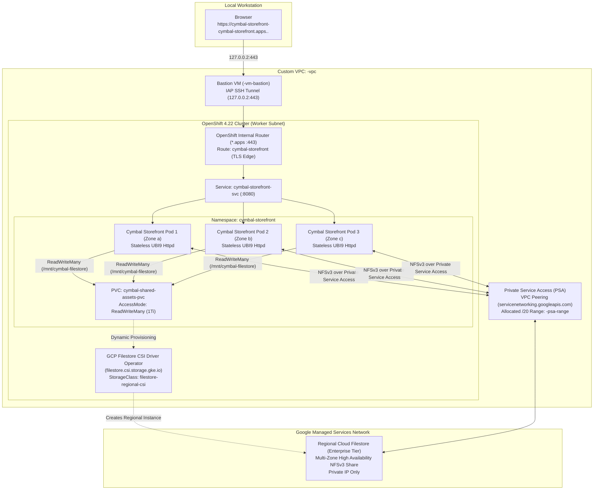
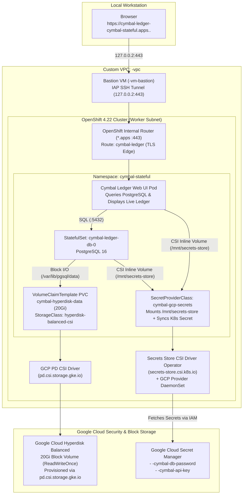

# Phase 2 Architecture: Cymbal Workloads on OpenShift & Google Cloud

This document describes the architecture for the two independent Phase 2 workload options running on the private Red Hat OpenShift Container Platform (OCP 4.22) cluster on Google Cloud.

---

## Option 1 Architecture: Stateless Cymbal Storefront with Regional Private Cloud Filestore

Option 1 demonstrates how a **stateless, multi-replica web tier** (`Cymbal Retail Storefront`) scales horizontally across multiple availability zones while reading and writing shared assets and real-time access logs on a **regional, private Google Cloud Filestore (`Enterprise` tier)** volume provisioned dynamically via the **GCP Filestore CSI Driver Operator**.

### Key Architectural Components (Option 1)
1. **Private Service Access (PSA) & VPC Peering**:
   - Because the OpenShift cluster is strictly private and uses custom subnets, regional Cloud Filestore (`Enterprise` tier) connects to `${PREFIX}-vpc` via **Private Service Access** (`servicenetworking.googleapis.com`) using a dedicated `/20` peering IP range (`${PREFIX}-psa-range`).
2. **GCP Filestore CSI Driver Operator**:
   - Installed in `openshift-cluster-csi-drivers` via Operator Lifecycle Manager (OLM) and managed through `ClusterCSIDriver` (`filestore.csi.storage.gke.io`).
   - Provides dynamic provisioning of regional `ReadWriteMany` (`RWX`) NFS volumes via `StorageClass` `filestore-regional-csi` (`tier: enterprise`, `connect-mode: PRIVATE_SERVICE_ACCESS`).
3. **Cymbal Retail Storefront (Stateless Multi-Replica Deployment)**:
   - Runs 3 stateless web replicas spread across worker nodes.
   - All 3 pods concurrently mount `/mnt/cymbal-filestore` (`ReadWriteMany`), sharing product catalog assets and appending real-time pod/node request telemetry so users can observe multi-pod `RWX` storage sharing in real time.

---

## Option 2 Architecture: Stateful Cymbal Ledger with Hyperdisk Block Storage & Secret Manager

Option 2 demonstrates how a **stateful database and transaction ledger** (`Cymbal Order & Inventory Ledger`) persists transactional data on **Google Cloud Hyperdisk Balanced** block storage (`ReadWriteOnce`) while mounting database credentials and API keys directly from **Google Cloud Secret Manager** using the **Secrets Store CSI Driver Operator**.

### Key Architectural Components (Option 2)
1. **Google Cloud Hyperdisk Balanced (`hyperdisk-balanced-csi`)**:
   - Uses the built-in OpenShift `pd.csi.storage.gke.io` CSI driver with `type: hyperdisk-balanced` and `volumeBindingMode: WaitForFirstConsumer`, matching the N4 worker nodes' next-generation Hyperdisk storage architecture.
2. **Secrets Store CSI Driver Operator + GCP Provider**:
   - Installs the OpenShift **Secrets Store CSI Driver Operator** (`secrets-store.csi.k8s.io`) and the **Google Cloud Provider DaemonSet** (`csi-secrets-store-provider-gcp`) in `openshift-cluster-csi-drivers`.
   - Uses a `SecretProviderClass` (`cymbal-gcp-secrets`) to fetch secrets directly from **Google Cloud Secret Manager** (`${PREFIX}-cymbal-db-password` and `${PREFIX}-cymbal-api-key`), mounting them as in-memory tmpfs files at `/mnt/secrets-store` and syncing them to an OpenShift `Secret` for database initialization.
3. **Cymbal Order & Inventory Ledger (`StatefulSet` + Web Dashboard)**:
   - **`cymbal-ledger-db` (`StatefulSet`)**: Runs PostgreSQL 16 backed by a dedicated 20 GiB `hyperdisk-balanced` persistent volume (`cymbal-hyperdisk-data-cymbal-ledger-db-0`).
   - **`cymbal-ledger-ui`**: Seeds and queries Cymbal retail inventory and order ledger records stored in PostgreSQL on Hyperdisk, displaying live database records, Hyperdisk volume metadata, and Secret Manager CSI mount verification.
